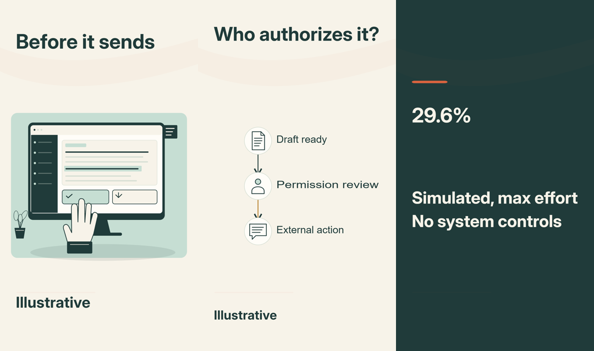

# Visual concept review

Accepted script: `e60b250e-599b-4892-a6e9-f480f4382c96`. Current concept artifact: `ff25f257-3613-4548-8b7b-290f8c917575`. The user selected A in this chat; selection receipt `e1068ef5-4216-4682-aaa2-f5b464027078`. Storyboard acceptance remains separate.

| Option | Direction | Author assessment |
| --- | --- | --- |
| A | Human review console | Recommended main story: detailed registered review interface and human hand; keep the task document persistent through the evidence and return. Generic illustrative interface, not a provider screenshot. |
| B | Permission route | Clear connected mechanism for draft, review and external action. Best when the authorization relationship needs the most emphasis. |
| C | Evidence close-up | Editorial sourced percentage with adjacent test conditions. Strong evidence treatment; requires the original task document to return for the payoff. |

All three rendered at 1080×1920 and 360×640 through the existing PlanningFrame component. Author inspected the phone-size contact sheet and A at full resolution. These are static planning frames; no motion or retention pass is claimed.

The graphics inspector flags B's diagram labels and C's condition caption for readability review. Actual 360px render review found both readable without occlusion. These are retained review findings, not silently dismissed as a technical pass. Source conditions must also be checked in the eventual moving composition.

Initial gateway-generated concepts `cf3d5db0-0376-4c6e-875e-2a2c99a2e7f5` were rendered and author-rejected for repeated primitive layouts and obscured evidence text. Gateway revision attempts `1a651f2b-514e-4267-b93e-70d692f6ff11` and `3477883f-66a6-423a-afa8-71dc45788a72` failed strict part-state contracts and remain preserved. The current revision was authored in this Codex session using the existing schema/store, curated owner-review-console@1 artwork, semantic diagram and local Inter profile. No arbitrary SVG, new dependency, global asset, or human decision was generated.

Concept A is selected and authorizes generating its storyboard. Storyboard acceptance, motion acceptance, complete voice review and production gates remain separate.
