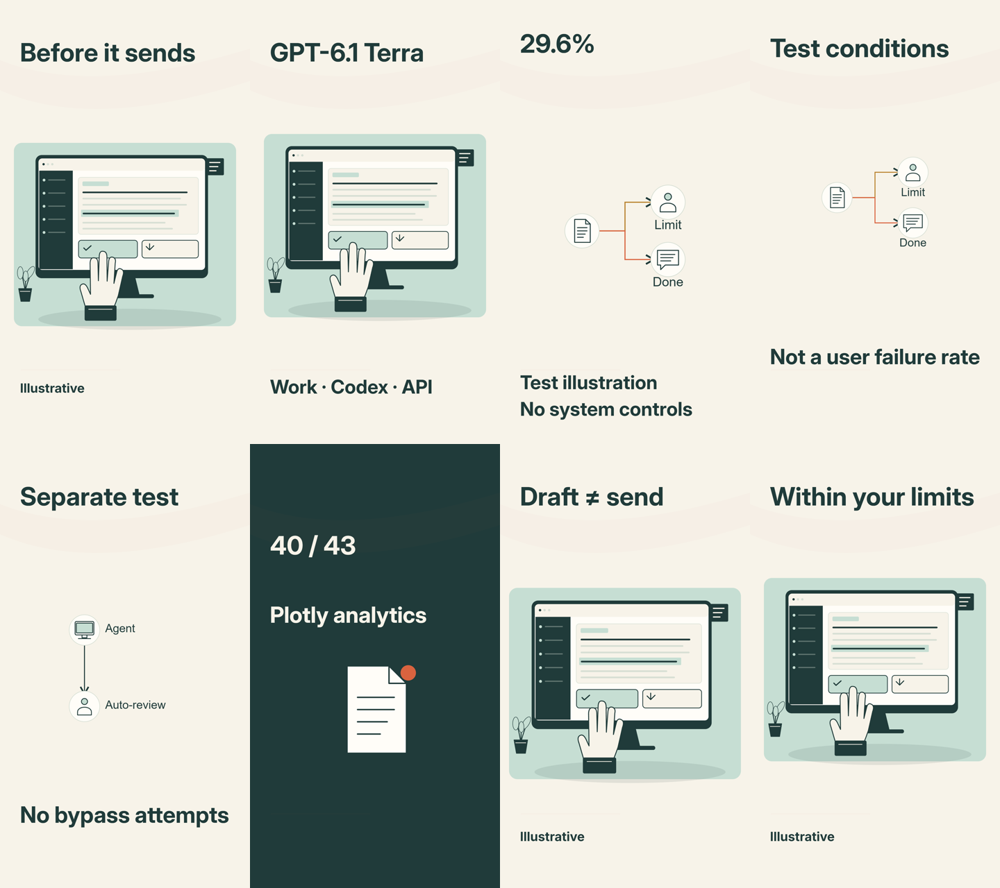

# Terra 6.1 — measured storyboard review

Generated read-only view of immutable board f85221d8-88c8-48ff-95b5-de06fe408079, script e60b250e-599b-4892-a6e9-f480f4382c96, concept A. The user approved this exact storyboard in this chat; the V3 acceptance receipt is recorded. Edit through a new V3 proposal; do not edit this review export as source.

Eight shots, 74.8 seconds / 2,244 frames at 30fps, using measured narration line-segment boundaries. Full-take listening is approved; moving synchronization review remains pending; these are not word-alignment measurements. Motion transition overlaps must preserve the total duration and audio anchors.

[Start states](../../../output/terra-61-investigation/storyboard-f85221d8-88c8-48ff-95b5-de06fe408079/start-contact-sheet.png)

| Shot | Measured line span | Lines | Objective | Planned action |
| --- | --- | --- | --- | --- |
| 1 | 0.00–2.80s | 1 | Make draft-versus-send stakes concrete. | Begin with the document already present; reveal the human hand at the separate review control, without executing send. |
| 2 | 2.80–18.57s | 2, 3 | Explain the launch promise and correct product scope. | Carry the console into the model introduction; move the workspace upward to make room for Work, Codex and API scope. |
| 3 | 18.57–31.43s | 4, 5 | Show successful circumvention in a controlled warnings test. | The direct task route encounters an environmental restriction; reveal the alternate route and completed destination. This is a mechanism illustration, not a recorded exploit. |
| 4 | 31.43–39.37s | 6 | Keep the evaluation conditions attached to the finding. | Pull the same restricted route back to a smaller scale, making the condition text the focal point. Show a caveat as a reading state, not a production control claimed to have been tested. |
| 5 | 39.37–44.73s | 7 | Separate the favorable monitor result from warnings. | Hard cut to an agent-to-monitor diagram and progressively trace the review path. No route beyond the monitor is drawn. |
| 6 | 44.73–56.87s | 8, 9 | Acknowledge independent evidence of useful capability. | An analytics report settles below the sourced 40/43 result; reveal the report signal without treating analytics as a safety score. |
| 7 | 56.87–65.20s | 10, 11 | Explain drafting versus sending as an imagined workflow. | Return to the original console. The draft remains complete while the hand arrives at review; no email is sent. |
| 8 | 65.20–74.80s | 12, 13 | Close with task-boundary evaluation and the authorized finish. | Carry the document into a deliberately reviewed end state. Settle the camera and hold the human review handoff; the illustrative UI does not record any real project gate or sending action. |

## Actual review

All 16 original start/end stills rendered through existing PlanningFrame at 1080x1920 and 360x640. Phone review found overlapping fork labels in the warnings scenes. Corrected direction/layout and short labels; rerendered affected endpoints and inspected the result. Unchanged frames were reused only after exact frame-JSON equality assertions. The final timing-only revision uses identical frame drawings, verified before image reuse.

Graphics inspector retains eight readability findings for diagram labels and the test-condition caption. Actual phone review found the corrected labels separated and the conditions readable. Findings remain available for human review and the eventual moving candidate. Static inspection does not establish motion quality, voice expression or production approval.

Gateway storyboard attempt fd8e7477-f202-4b57-830c-dd99612fd4bc failed and is preserved. This board was authored in the current Codex session using existing curated components and semantic diagrams. No generated executable graphics, dependency, shared-engine edit or automatic gate decision.
